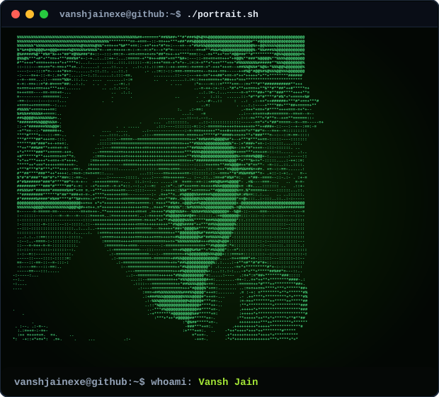

<!-- UNBOXED TWO-COLUMN SPLIT HERO SECTION -->
<table width="100%" style="border: none; border-collapse: collapse;">
  <tr>
    <td width="46%" valign="middle" align="center" style="border: none; padding: 0;">
      
    </td>
    <td width="4%" style="border: none;">&nbsp;</td>
    <td width="50%" valign="middle" align="center" style="border: none; padding: 0;">
      <h1 style="margin: 0 0 4px 0; font-size: 38px; font-weight: 800; letter-spacing: -1px; color: #ffffff; font-family: -apple-system, BlinkMacSystemFont, 'Segoe UI', Helvetica, Arial, sans-serif;">VANSH JAIN</h1>
      

        Mumbai, India
      

      

        &nbsp;
        &nbsp;
        &nbsp;
        &nbsp;
        
      

      

        Systems architecture, sub-second AI voice pipelines, competitive programming, and visual engineering.
      

    </td>
  </tr>
</table>

  

<!-- 01 // THE STACK -->
<table width="100%" style="background: #0d1117; border: 1px solid #30363d; border-radius: 8px; border-collapse: separate; border-spacing: 0;">
  <tr>
    <td align="center" style="padding: 24px;">
      
        
      

        
      

       
      

        &nbsp;&nbsp;
        &nbsp;&nbsp;
        &nbsp;&nbsp;
        &nbsp;&nbsp;
        &nbsp;&nbsp;
        &nbsp;&nbsp;
        &nbsp;&nbsp;
        &nbsp;&nbsp;
        &nbsp;&nbsp;
        
      

    </td>
  </tr>
</table>

  

<!-- 02 // WHAT I'M BUILDING NOW -->
<table width="100%" style="background: #0d1117; border: 1px solid #30363d; border-radius: 8px; border-collapse: separate; border-spacing: 0;">
  <tr>
    <td align="left" style="padding: 24px;">
      

        
      

       
      <h2 style="margin: 0 0 6px 0; font-size: 24px; font-weight: 800; color: #ffffff;">
        XEMO
      </h2>
      

        &nbsp;
        &nbsp;
        &nbsp;
        
      

      

        A real-time AI intellectual speaking and voice debate platform. Engineered for sub-second vocal sparring using persistent bi-directional WebSockets, custom C++ audio streaming logic ported from Python, Deepgram speech pipelines, and Groq LPU inference. Fully instrumented with PostHog analytics and shipped to production.
      

    </td>
  </tr>
</table>

  

<!-- 03 // SPEED TELEMETRY -->
<table width="100%" style="background: #0d1117; border: 1px solid #30363d; border-radius: 8px; border-collapse: separate; border-spacing: 0;">
  <tr>
    <td align="left" style="padding: 24px;">
      

        
      

       
      

        ⚡ <b>Level 230</b> &bull; Peak Velocity: <b>215 WPM</b> (10 Words) &bull; Top 1.5% (15s) &bull; Top 1% (60s)
      

      
      

        
      

      

        

          
10 Words

          
215 WPM

          
100% Acc &bull; 88% Con

        

        

          
15 Seconds

          
175 WPM

          
100% Acc &bull; 88% Con

        

        

          
25 Words

          
164 WPM

          
100% Acc &bull; 72% Con

        

        

          
30 Seconds

          
152 WPM

          
97% Acc &bull; 80% Con

        

        

          
50 Words

          
150 WPM

          
97% Acc &bull; 85% Con

        

        

          
60 Seconds

          
148 WPM

          
96% Acc &bull; 79% Con

        

        

          
120 Seconds

          
128 WPM

          
94% Acc &bull; 75% Con

        

      

    </td>
  </tr>
</table>

  

<!-- 04 // AWARDS & HONORS -->
<table width="100%" style="background: #0d1117; border: 1px solid #30363d; border-radius: 8px; border-collapse: separate; border-spacing: 0;">
  <tr>
    <td align="center" style="padding: 24px;">
      
        
      

        
        
        
        
      

    </td>
  </tr>
</table>

  

<!-- 05 // BIO & ORIGIN -->
<table width="100%" style="background: #0d1117; border: 1px solid #30363d; border-radius: 8px; border-collapse: separate; border-spacing: 0;">
  <tr>
    <td align="left" style="padding: 24px;">
      

        
      

       
      

        I started writing code when I was 10 years old, driven entirely by the obsessive urge to build my own version of Jarvis from scratch. Long before software took over my life, I spent my childhood drawing for 10 hours a day—obsessing over human anatomy, lighting, and spatial perspective. That relentless visual foundation naturally bled into video editing, 3D motion design, and high-craft UI engineering.
      

      

        Right now, I am going deep into the mathematical foundations of computer science and competitive programming. When I'm not studying or pushing code, I'm conducting cybersecurity research, designing production-grade consumer mobile apps, and building systems at the absolute edge of performance.
      

    </td>
  </tr>
</table>

  

  

 
